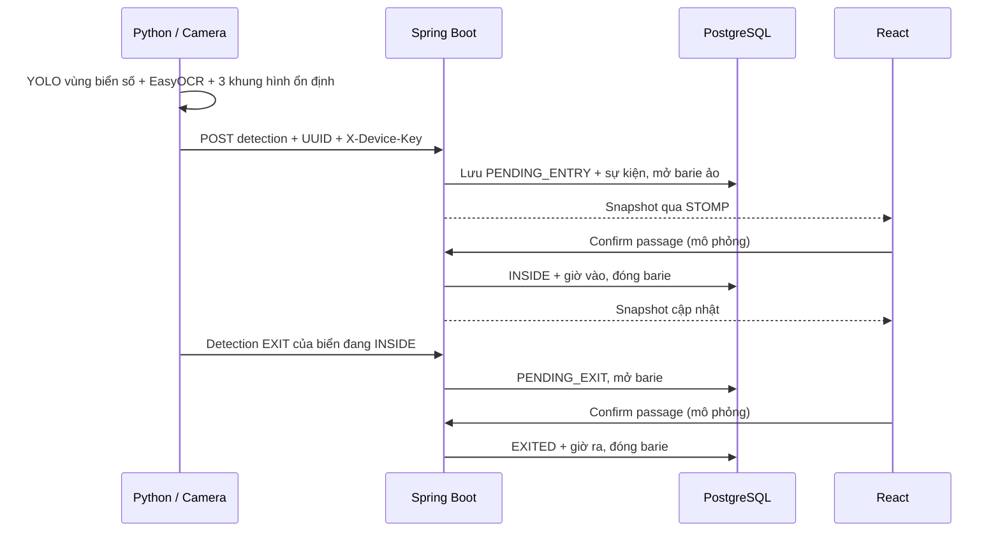

# Biển số, lượt xe và barie mô phỏng

Cập nhật 07/11/2026. Chạy tại `/home/phambuuthinh/Downloads/IOT-PROJECT`.

## Đã triển khai

- React: mục **Vehicle access**, nhập biển số, chọn Entry/Exit, barie chuyển động, danh sách lượt vào/ra, tìm theo biển số và nhật ký.
- Spring Boot 3 + Spring JDBC + PostgreSQL: lưu lượt xe, trạng thái barie ảo và sự kiện; Flyway V4 tự tạo thêm 3 bảng. Không sử dụng JPA/Hibernate.
- WebSocket/STOMP `/topic/parking` cập nhật các tab. Có HTTP polling dự phòng.
- Python: giữ nguyên `demo/best.pt` của nhóm, thêm lọc lớp biển số, OCR có điểm tin cậy, đọc biển hai dòng, đồng thuận nhiều khung hình và gửi HTTP ngoài vòng xử lý camera.
- Mặc định là **barie ảo**. Có cầu nối laptop tùy chọn gửi yêu cầu mới tới ESP32/servo: xem [ESP32_SETUP.md](ESP32_SETUP.md). Khi bridge chạy, Confirm passage / close là xác nhận của người vận hành và có thể gửi lệnh đóng thật; chưa có cảm biến xác nhận xe đi qua.

Luồng camera gốc của nhóm và kiểm tra đăng ký: [Project/Camera/run.md](../Project/Camera/run.md).

## Luồng hoạt động



Nhận diện không tự chứng minh xe đã qua cổng. Vì vậy giờ vào/ra chỉ ghi khi **Confirm passage**. Cancel / close hủy lượt chờ vào; nếu đang chờ ra thì khôi phục Inside. Một biển chỉ có một lượt đang hoạt động. Barie xử lý từng lượt, không nhận hàng chờ tự động. Tối đa 4 lượt hoạt động, kể cả lượt chờ vào.

Số xe trong sổ vào/ra độc lập với cảm biến P01–P04: chưa xác định được biển nào đỗ ô nào. Không tự thay đổi Available/Occupied khi mở barie.

## Chạy và demo nhanh

```bash
cd /home/phambuuthinh/Downloads/IOT-PROJECT
npm run backend:up
npm run dev
```

Mở `http://localhost:5173`.

**Simulation:** cuộn tới Vehicle access → nhập `43A-123.45` → Entry → Simulate detection → thấy Awaiting entry và barie mở → Confirm passage → Inside. Chuyển Exit → Simulate detection → Confirm passage → Exited. Reset vehicle demo chỉ xóa dữ liệu demo trong bộ nhớ; không ghi DB.

**Device:** backend phải chạy; `.env` cần dòng:

```dotenv
ACCESS_SIMULATION_ENABLED=true
```

Chạy lại `npm run backend:up` sau khi đổi cấu hình. Máy hiện đã bật cờ này để demo. Thao tác tương tự trong Device sẽ ghi PostgreSQL, gắn source SIMULATION và giữ lịch sử sau khi tải lại. Các nút demo không chứa device key. Khi đưa backend lên công khai, cờ mặc định **false**; bật true cho phép người truy cập API demo ghi dữ liệu mô phỏng, nên chỉ bật trong môi trường thử nghiệm có kiểm soát. Khi false, vẫn nhận detection có key nhưng chưa có luồng passage phần cứng.

Thử báo nhiệt: Simulation → Simulate heat → barie giữ mở, không cho đóng bằng tay → Cool down → hết override. Device sử dụng dữ liệu nhiệt đã lưu: bật ở >=50°C, tắt <=45°C, giữ latch ở giữa. Mất dữ liệu không đồng nghĩa hết báo cháy; backend giữ yêu cầu mở nếu alarm đã latch. Sau khi hết override, barie trở về trạng thái nền trước đó; lượt đang chờ vẫn cần xác nhận/hủy.

Để chỉ thử cầu nối Python, không cần cài YOLO/camera:

```bash
python3 demo/main.py --mock-plate 43A-456.78 --send
# Mở Device -> Confirm passage
python3 demo/main.py --mock-plate 43A-456.78 --direction EXIT --send
# Device -> Confirm passage lần nữa
```

`--mock-plate` là chuỗi giả lập rõ ràng, không phải nhận diện thật. Nó thử endpoint camera có key, vì vậy ledger hiện **Camera API** (kênh nhận dữ liệu); `cameraId=mock-demo` trong sự kiện chỉ rõ nguồn thử. Nhãn này không chứng minh ESP hay camera vật lý đang online. API key đọc từ `.env` ở gốc dự án, không in ra terminal và không đưa lên frontend.

## Chạy camera / video thật

```bash
cd /home/phambuuthinh/Downloads/IOT-PROJECT
python3 -m venv demo/.venv
demo/.venv/bin/python -m pip install -r demo/requirements.txt
# Mặc định dry run: chỉ in kết quả, không ghi database
demo/.venv/bin/python demo/main.py --source 0 --direction ENTRY
# Sau khi kiểm tra OCR đúng, bật HTTP
demo/.venv/bin/python demo/main.py --source 0 --direction ENTRY --send
# Dùng video thay webcam
demo/.venv/bin/python demo/main.py --source /path/to/gate-video.mp4 --direction ENTRY
```

Nếu class name trong weights không phải `plate`, `license_plate`, `licence_plate`, `number_plate`, `bien_so` (bỏ dấu phân cách), chương trình dừng và in bảng lớp. Chọn **đúng ID lớp biển số**, ví dụ thêm `--plate-class 0` **chỉ khi bảng lớp xác nhận ID 0 là biển số**. Không áp dụng mapping model cứu hộ trước đây. Không OCR mọi bbox xe/người/thùng hàng.

Weights hiện có được giữ nguyên, chưa xác minh accuracy/class labels bằng thư viện ML trong lượt này. Nếu model chỉ detect biển số thì nó không đồng thời trở thành model detect toàn xe. Muốn nhận dạng thêm car/motorcycle cần model tương ứng và kiểm chứng riêng. EasyOCR có thể tải model OCR ở lần chạy đầu. Hỗ trợ `--gpu-ocr` nếu môi trường CUDA phù hợp.

Điểm nhận diện mặc định >=0.75 cho cả YOLO và OCR (lấy min), không phải xác suất đúng đã hiệu chuẩn. Đồng thuận 3 khung liên tiếp, chỉ một biển hợp lệ trong khung, cooldown 30s và cần biển rời khỏi tầm nhìn để tái kích hoạt cùng biển. Có thể chỉnh `--stable-frames`, `--cooldown`, `--min-confidence`; cần dữ liệu camera thật để chọn ngưỡng. Format hiện hỗ trợ một nhóm biển Việt Nam thông dụng, không bao phủ mọi biển đặc biệt/nước ngoài.

Python gửi qua hàng đợi tối đa 8; retry tối đa 4 lần với backoff và **giữ nguyên eventId/payload**. 4xx không retry, trừ 408/429. Quan sát mới phải trong 60s quá khứ/30s tương lai; cần đồng hồ máy đúng. Khi lỗi, terminal báo NOT SAVED/needs operator check; không có hàng đợi bền vững qua restart. Kiểm tra sổ trên web trước khi gửi lại. UUID trùng cùng payload trả duplicate, không mở cổng lại; UUID trùng dữ liệu khác trả409. Lặp biển ENTRY khi đã Inside không tạo thêm lượt.

Đổi hướng ENTRY/EXIT theo cổng/camera, không đoán hướng từ việc biển xuất hiện. Chưa hỗ trợ nhiều xe cùng lúc trong một ảnh, tính phí hay lưu ảnh. Backend hiện kiểm tra danh sách đăng ký trước khi tạo yêu cầu mở; xem [Project/Camera/run.md](../Project/Camera/run.md).

## API

| Method/path | Mục đích |
| --- | --- |
| GET `/api/access/status` | Barie, thống kê lượt, 100 lượt active-first và 30 sự kiện gần nhất |
| GET `/api/parking/status` | Snapshot chung, có `access` |
| POST `/api/device/vehicle-detections` | Python gửi detection, bắt buộc `X-Device-Key` |
| POST `/api/access/simulation/detections` | Web gửi detection giả lập, chỉ khi cờ demo true |
| POST `/api/access/simulation/barrier` | OPEN/CLOSE/PASSAGE ảo, UUID + expectedVersion |

Ví dụ body detection:

```json
{
  "eventId": "6af681a7-6c5d-42bd-90c8-b6a3ed7b57a0",
  "plate": "43A12345",
  "direction": "ENTRY",
  "confidence": 0.92,
  "cameraId": "gate-entry"
}
```

Python thêm `observedAt` UTC. Kết quả gồm `outcome`, `visitId`, `duplicate`, `snapshot`. HTTP200 chỉ nghĩa đã xử lý: phải xem outcome, vì BARRIER_BUSY/CAPACITY_REACHED/FIRE_OVERRIDE không cho lượt đi qua. Lệnh barie cần `eventId` mới, `action` và `expectedVersion` lấy từ snapshot hiện tại; phiên cũ trả409 để tránh thao tác nhầm. Fire override chặn thao tác đóng/passage và không tự ghi lượt xe.

## Database / DBeaver

Ba bảng mới:

| Bảng | Nội dung |
| --- | --- |
| `vehicle_visit` | Biển chuẩn hóa, trạng thái lượt, nguồn, thời điểm tạo/vào/ra |
| `vehicle_access_event` | Mỗi detection/lệnh, UUID chống trùng, confidence, cameraId và kết quả |
| `virtual_barrier` | Một dòng barie ảo, phiên bản, lượt đang chờ; fire override tính từ latch nhiệt |

Mở connection parking → SQL Editor (F3 hoặc chuột phải connection → SQL Editor → New SQL Script), chạy câu chọn bằng Ctrl+Enter:

```sql
SELECT id, plate, status, source, created_at, entry_at, exit_at
FROM vehicle_visit ORDER BY id DESC LIMIT 100;

SELECT id, event_id, kind, plate, direction, confidence, camera_id,
       source, outcome, visit_id, created_at
FROM vehicle_access_event ORDER BY id DESC LIMIT 50;

SELECT * FROM virtual_barrier;

SELECT status, count(*) FROM vehicle_visit GROUP BY status;

SELECT installed_rank, version, description, success
FROM flyway_schema_history ORDER BY installed_rank;
```

`virtual_barrier.position` là trạng thái nền. Khi báo nhiệt latch, trạng thái hiệu lực OPEN/FIRE_OVERRIDE xem qua `/api/access/status`; không suy ra chỉ từ dòng barie. Không sửa/xóa trực tiếp bảng để đóng cổng vì dễ phá quan hệ giữa lượt và barie.

## Kiểm chứng và giới hạn bàn giao

- 24 kiểm thử Java/PostgreSQL: validation/key, UUID/replay/concurrency, passage, cancel, capacity, fire override và regression parking/nhiệt.
- 22 kiểm thử Node: trạng thái frontend, parser, vào/ra/capacity/fire.
- 4 kiểm thử Python không cần ML: consensus/cooldown, OCR hai dòng, HTTP retry cùng payload và401 không retry.
- Production build thành công. Browser Chromium: demo local/server, reload giữ lịch sử, hai tab nhận realtime từ Python mock, local/server fire override, không tràn trang ở320/390/768/1440px.
- Chưa kiểm chứng camera/video thật hoặc độ chính xác `best.pt` vì môi trường chưa cài ML; chưa test ESP32/servo. Không tự deploy/push thay đổi này lên Vercel.

```bash
npm test
npm run test:backend
python3 -m unittest discover -s demo -p 'test_*.py'
npm run build
```

API thư viện tham khảo: [Ultralytics predict](https://docs.ultralytics.com/modes/predict/), [EasyOCR readtext](https://www.jaided.ai/easyocr/documentation/).
